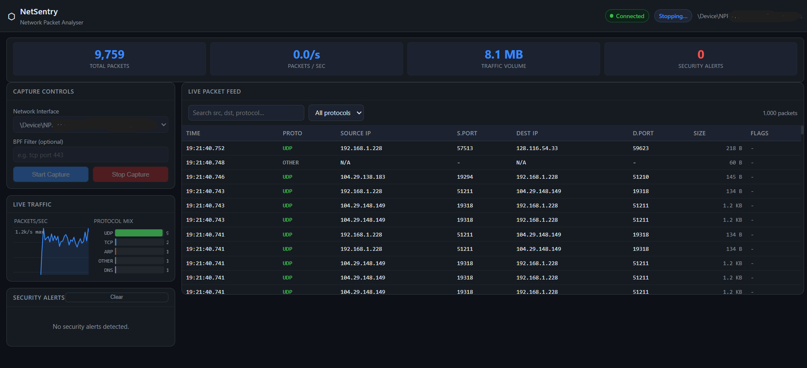

# NetSentry — Advanced Python Packet Sniffer

NetSentry is a Python-based network packet monitoring tool with a desktop GUI and a browser-based dashboard. Built with Scapy, PySide6, FastAPI, and WebSockets, it provides real-time packet visibility, traffic statistics, and security alert monitoring.

## Features

### Network Monitoring
- Capture and monitor network packets in real time.
- Inspect packet source and destination addresses.
- View protocols, packet sizes, TCP flags, and timestamps.
- Monitor network traffic through a desktop application or browser dashboard.

### Security Monitoring
- Detect suspicious network activity using a security detection module.
- Display security alerts alongside captured traffic.
- Monitor packet activity and traffic statistics in real time.

### Desktop Application
- GUI built with PySide6.
- Real-time packet display.
- Packet statistics and security alerts.
- Dedicated packet capture worker to keep the interface responsive.

### Web Dashboard
- Browser-based interface powered by FastAPI.
- Live packet updates using WebSockets.
- Start and stop packet capture from the dashboard.
- Real-time traffic statistics and protocol visualization.
- Packet table and security alert history.
- Responsive dark-themed interface.

## Screenshots

### Desktop Application


### Desktop Security Alerts


### Web Dashboard



## Technology Stack

- **Python 3.11**
- **Scapy** — packet capture and network packet analysis
- **PySide6** — desktop GUI
- **FastAPI** — web application backend
- **Uvicorn** — ASGI server
- **WebSockets** — live dashboard updates
- **PyQtGraph** — data visualization

## Project Structure

```text
NetSentry/
├── main.py
├── run_gui.py
├── run_web.py
├── netsentry/
│   ├── __init__.py
│   ├── gui.py
│   ├── capture_worker.py
│   ├── packet_utils.py
│   ├── security_detector.py
│   └── web/
│       ├── __init__.py
│       ├── app.py
│       ├── capture_worker.py
│       ├── test_app.py
│       ├── test_capture_worker.py
│       └── static/
│           ├── index.html
│           ├── style.css
│           └── app.js
├── captures/
├── screenshots/
├── requirements.txt
├── .gitignore
└── README.md
```

## Requirements

- Windows, Linux, or another operating system supported by the required Python packages.
- Python 3.11 recommended.
- Npcap on Windows for packet capture.
- Administrator/root privileges may be required to capture packets, depending on the operating system and capture interface.

## Installation

### 1. Clone the repository

```bash
git clone https://github.com/Chaos322/NetSentry.git
cd NetSentry
```

### 2. Create a virtual environment

```bash
python -m venv venv
```

Activate it on Windows PowerShell:

```powershell
.\venv\Scripts\Activate.ps1
```

### 3. Install dependencies

```bash
python -m pip install --upgrade pip
pip install -r requirements.txt
```

### 4. Install Npcap on Windows

Install Npcap from the official website if it is not already installed:

https://npcap.com/

Follow its installation instructions and ensure packet capture is enabled for your environment.

## Running NetSentry

### Desktop Application

Run:

```bash
python run_gui.py
```

The desktop application should open in a separate window.

### Browser-Based Dashboard

Run:

```bash
python run_web.py
```

Open the following URL in your browser:

http://127.0.0.1:8000

Keep the terminal running while using the dashboard. Press `Ctrl+C` in the terminal to stop the web server.

## Running Tests

Run the web application tests:

```bash
python -m pytest netsentry/web/test_app.py -v
```

Run the packet capture worker tests:

```bash
python -m pytest netsentry/web/test_capture_worker.py -v
```

Run all tests:

```bash
python -m pytest -v
```

## Important Notes

- Only capture network traffic on systems and networks you own or have explicit permission to monitor.
- Packet capture may require elevated privileges.
- Captured traffic can contain sensitive information. Keep capture files private and handle them responsibly.
- Local packet capture availability depends on your operating system, permissions, network interface, and Npcap configuration.
- The web dashboard is configured to run locally at `127.0.0.1` by default. Avoid exposing it to untrusted networks without appropriate security controls.
- Automated tests do not replace testing packet capture on your own system.

## Future Improvements

Potential future enhancements include:

- More advanced traffic filtering and packet inspection.
- Expanded security detection rules.
- Exportable traffic statistics and reports.
- Improved alert categorization and analysis.
- Additional dashboard customization.

## License

This project is distributed under the license included in the repository. See the `LICENSE` file for details.

## Author

Developed as a Python-based network monitoring and cybersecurity project.
