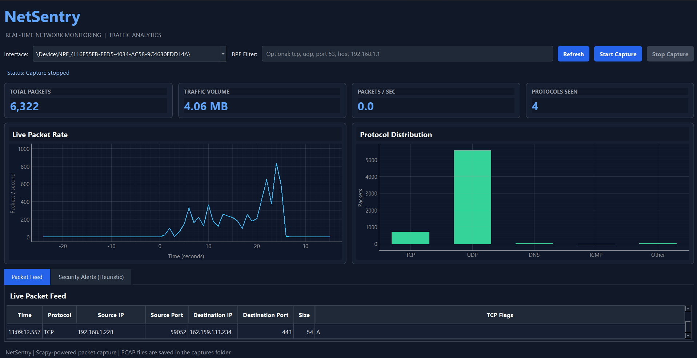
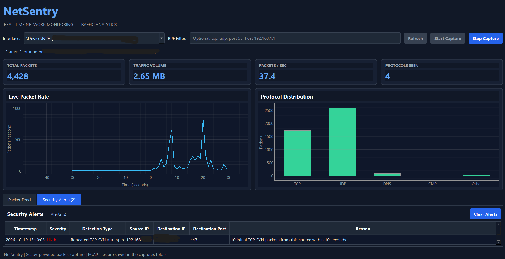

# NetSentry — Network Packet Sniffer & Analyzer

NetSentry is a Python-based network packet sniffer and analyzer featuring a desktop GUI built with PySide6. It provides real-time network traffic monitoring, protocol statistics, packet inspection, PCAP capture saving, and rule-based security alerts.

The project demonstrates practical skills in network analysis, Python development, multithreading, GUI engineering, and defensive cybersecurity.

## Features

- **Live packet capture** — Capture network traffic using Scapy and Npcap.
- **Interactive desktop GUI** — Monitor network activity through a dark-themed PySide6 interface.
- **Network interface selection** — Select and refresh available network interfaces.
- **BPF filtering** — Filter captured traffic using Berkeley Packet Filter expressions, such as `tcp`, `udp`, and `port 53`.
- **Live traffic dashboard** — Monitor packet rate, total packets, traffic volume, and protocol distribution.
- **Packet inspection** — View timestamps, protocols, source and destination addresses, ports, packet sizes, and TCP flags.
- **PCAP export** — Save captured traffic for later analysis using compatible packet-analysis tools.
- **Security alerts** — Apply heuristic rules to flag repeated TCP SYN attempts and traffic to configurable watched destination ports.
- **Responsive capture architecture** — Run packet capture in a background worker and deliver packet updates in batches.
- **Resource-conscious display** — Limit the visible packet feed to reduce GUI overhead during high-volume capture.

## Technology Stack

| Technology | Purpose |
|---|---|
| Python 3.11 | Application development |
| Scapy | Packet capture and packet analysis |
| PySide6 | Desktop GUI |
| pyqtgraph | Real-time traffic visualization |
| Npcap | Windows packet-capture support |
| QThread | Background capture processing |

## Project Structure

```text
PacketSniffer/
├── main.py
├── run_gui.py
├── netsentry/
│   ├── __init__.py
│   ├── gui.py
│   ├── capture_worker.py
│   └── security_detector.py
├── captures/
├── screenshots/
├── requirements.txt
├── .gitignore
└── README.md
```

The `main.py` file contains the original command-line sniffer and shared packet-analysis helpers. The `run_gui.py` file launches the desktop application.

## Requirements

- Windows 11 (Windows 10 may also work with a compatible setup)
- Python 3.11
- Npcap installed and configured for packet capture
- Visual Studio Code or another Python-compatible editor
- Administrator privileges if required by your Windows/Npcap configuration

## Installation

### 1. Install Python

Install Python 3.11 and ensure the Python launcher or executable is available from your terminal.

Verify your installation:

```powershell
py -3.11 --version
```

### 2. Install Npcap

Download Npcap from the official website:

https://npcap.com/

Follow its installation instructions. Packet capture may require elevated privileges depending on the Npcap configuration and Windows permissions.

### 3. Clone the repository

```powershell
git clone https://github.com/YOUR_USERNAME/NetSentry.git
cd NetSentry
```

Replace `YOUR_USERNAME` with your GitHub username.

### 4. Create a virtual environment

```powershell
py -3.11 -m venv venv
.\venv\Scripts\Activate.ps1
```

A virtual environment keeps this project's Python packages separate from other projects.

If PowerShell blocks activation, you can run the virtual environment's Python directly instead of changing system-wide execution policy.

### 5. Install dependencies

```powershell
python -m pip install --upgrade pip
python -m pip install -r requirements.txt
```

### 6. Launch NetSentry

```powershell
python run_gui.py
```

Select an available network interface, optionally enter a BPF filter, and click **Start Capture**.

Click **Stop Capture** to finish the session and save the captured packets.

## Usage

### Packet Monitoring

1. Launch the application.
2. Select the network interface you want to monitor.
3. Optionally enter a BPF filter.
4. Start the capture.
5. Inspect packets in the live packet feed.
6. Review the dashboard's packet-rate graph and protocol distribution.
7. Stop the capture when finished.

Example BPF filters:

| Filter | Description |
|---|---|
| `tcp` | TCP traffic |
| `udp` | UDP traffic |
| `port 53` | Traffic using port 53 |
| `icmp` | ICMP traffic |
| `host 192.168.1.1` | Traffic to or from the specified host |

### Security Alerts

Open the Security Alerts tab to view detections produced by the configured rules.

Current rules include:

- Repeated initial TCP SYN attempts from a source within a configured time window.
- Traffic directed to configured watched destination ports.

These rules use heuristics. A flagged connection or port does not establish that an attack occurred, and legitimate activity can trigger an alert.

### PCAP Files

Capture files are saved in the local `captures/` directory. They can be analyzed later using Wireshark or other compatible tools.

Captured traffic may contain sensitive metadata or application information. Handle these files carefully.

## Screenshots

### Live Traffic Dashboard



### Security Alerts



## Current Limitations

- Packet visibility depends on the selected interface, capture permissions, and BPF filter.
- The dashboard describes captured traffic, not necessarily every packet on the network.
- Security detections are rule-based heuristics rather than a validated intrusion detection system.
- Watched ports and repeated SYN traffic can produce false positives.
- The application does not establish whether a connection succeeded or prove malicious intent.
- Traffic analysis may be limited when protocols are encrypted.
- Performance depends on packet volume, system resources, and capture configuration.

## Responsible Use

Use NetSentry only on networks and devices you own or are explicitly authorized to monitor.

Respect privacy, applicable laws, organizational policies, and data-handling requirements. Do not publish PCAP files containing private or sensitive traffic.

## Future Improvements

Potential future enhancements include:

- Configurable detection thresholds through the GUI.
- Additional traffic anomaly detection rules.
- Exportable security alert reports.
- Dashboard performance and usability improvements.
- Automated tests for packet classification and detection rules.

## Author

Developed as a hands-on Python and defensive cybersecurity project.

## License

This project is licensed under the MIT License — see the [LICENSE](LICENSE) file for details.
